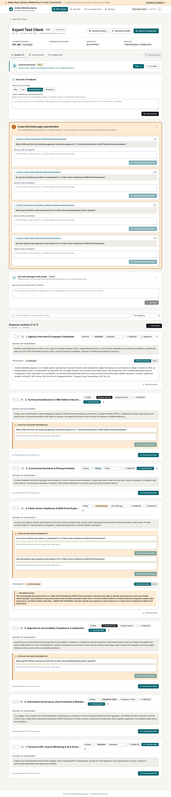
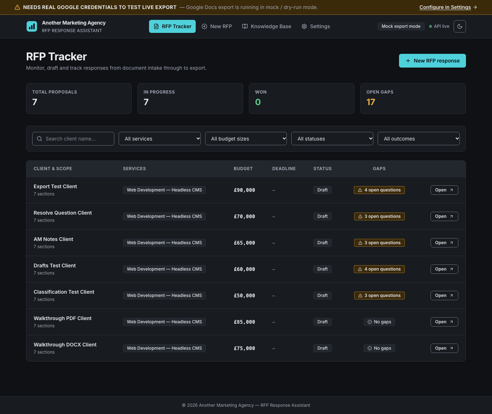
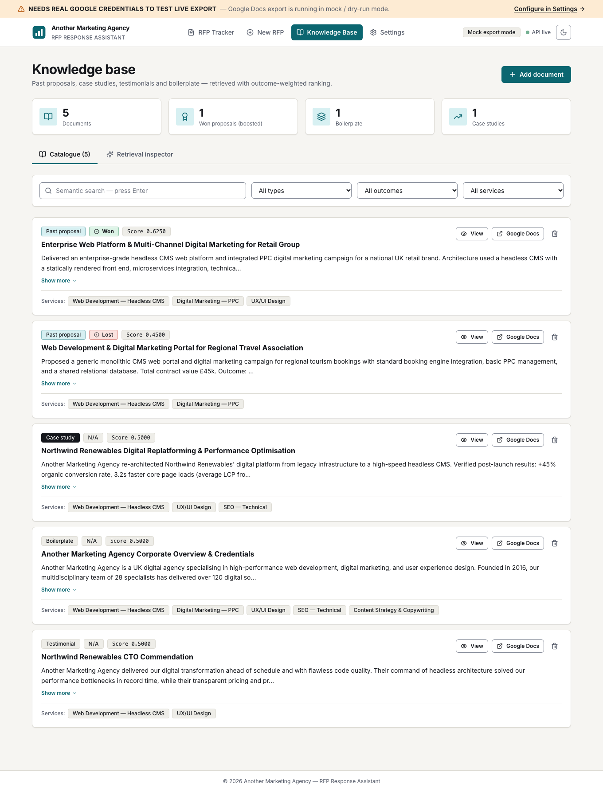
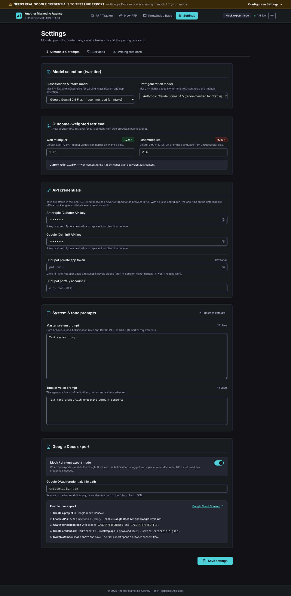

# RFP Response Assistant

[](https://github.com/tominniss-stack/RFP_responder/actions/workflows/ci.yml)
[](LICENSE)
[](docs/TESTING.md#accessibility-audit)

An internal tool for a fictional digital agency — **Another Marketing Agency** — that turns an incoming RFP (PDF or DOCX) into a first-draft proposal. It parses the brief into sections, classifies each one, pulls exact pricing and past-proposal evidence from a knowledge base, drafts a response with an LLM, flags every gap it can't fill as an open question, and exports the result to Google Docs with the gaps anchored as comments.

The design bias throughout is **never guess**: pricing is injected verbatim from a structured price list or marked as a gap, and the engine that produced each draft (Claude, Gemini or the deterministic mock) is always reported to the user.

<p align="center">
  
  
</p>

---

## What it does

| Stage | Behaviour |
|---|---|
| **Intake** | Upload `.pdf`/`.docx` or create manually. Sections are split on heading styles, then markdown/numbered headers, then paragraph breaks. |
| **Classification** | Each section is labelled `pricing`, `boilerplate`, `strategic`, `compliance/admin` or `gap` by the configured LLM. Manual override available. The response carries `X-LLM-Engine` / `X-LLM-Model` headers so the UI can show which engine ran. |
| **Draft generation** | Per section or batch (*Generate all drafts*). Inputs are combined in strict precedence: section-specific account-manager note → whole-RFP note → exact price items for linked services → outcome-biased RAG over past proposals → boilerplate. Every source is recorded as **provenance**. |
| **Gap handling** | Missing pricing/evidence inserts a `[MORE INFO REQUIRED: …]` marker and auto-creates an **open question**. Resolving it with evidence clears the marker and lets you regenerate. |
| **Outcome learning** | Mark proposals won/lost. Retrieval weights won proposals up and lost ones down (`weight_won` / `weight_lost` are tunable in Settings with a live benchmark). |
| **Export** | Google Docs + Drive API with each unresolved question anchored as a comment. Defaults to a **mock/dry-run mode** that logs the full payload so the pipeline is testable without credentials. |

## Architecture at a glance

```
frontend/  React 18 · Vite 6 · Tailwind 3 (CSS-variable design tokens, class-based dark mode)
backend/   FastAPI · SQLite (WAL, FK on) · zero-dependency LLM clients (urllib) · pure-Python TF-IDF
           vector store with optional ChromaDB · Google Docs/Drive export (optional google-api-python-client)
tests/     unittest — 108 backend unit · 210 root integration/adversarial · 79 tiered E2E
```

Full detail in [`docs/ARCHITECTURE.md`](docs/ARCHITECTURE.md). Test strategy in [`docs/TESTING.md`](docs/TESTING.md).

## Quick start

**Prerequisites:** Python 3.10+, Node 18+.

```bash
git clone https://github.com/tominniss-stack/RFP_responder.git
cd RFP_responder
./start.sh                 # installs deps, seeds the DB, starts backend :4010 and frontend :3010
```

Open <http://localhost:3010>. The seed includes a fictional service catalogue, price list and three past proposals (two won, one lost) so RAG biasing is observable immediately.

Other launch modes:

```bash
./start.sh --setup-only    # install + seed, don't start servers
./start.sh --ci            # non-interactive: start, health-check, run tier runner, exit
./start.sh --port-backend 8000 --port-frontend 5173
MOCK_LLM=1 ./start.sh      # force the deterministic mock engine regardless of API keys
```

### Docker (mock-mode demo)

```bash
docker compose up --build   # frontend on :3010, backend on :4010, MOCK_LLM=1
```

## Configuration

Everything runtime-configurable lives in **Settings** (persisted in the `settings` table) — no `.env` is required to run.

| Setting | Notes |
|---|---|
| Classification model / Generation model | Independent. Gemini and Claude models supported; defaults `gemini-2.5-flash` and `claude-sonnet-4-5`. |
| API keys | Stored server-side; the API returns them **masked** (`••••` + last 4) and ignores a masked value on write, so the UI never round-trips a secret. |
| System prompt / Tone of voice | Editable with reset-to-default. |
| Mock Google export | On by default. See *Live export* below. |
| HubSpot | Optional deal sync stub (API key + portal ID). |

Environment variables (all optional): `PORT` (4010), `HOST`, `RELOAD`, `DATABASE_PATH`, `MOCK_LLM=1`, `CORS_ORIGINS` (comma-separated extra origins); `VITE_PORT` (3010) and `VITE_BACKEND_PORT` (4010) for the frontend dev server and its `/api` proxy.

### Live Google Docs export

Out of the box the app runs in mock export mode and shows a banner — **NEEDS REAL GOOGLE CREDENTIALS TO TEST LIVE EXPORT** — with a link to Settings. To go live:

**Google Cloud OAuth Setup**

1. Create a Google Cloud project, enable **Docs API** and **Drive API**, create a **service account** and download its JSON key.
2. Save it as `credentials.json` in the repo root (git-ignored; see [`credentials.json.placeholder`](credentials.json.placeholder)).
3. `pip install google-api-python-client google-auth` (listed as an optional extra in [`backend/requirements.txt`](backend/requirements.txt)).
4. In **Settings → Export**, turn off *Mock export* and point *Credentials path* at the file.

If the credentials file is missing or the libraries aren't installed, live export fails loudly (HTTP 400/500) rather than silently falling back.

## Design system

Colour is expressed only through semantic tokens — `canvas`, `surface`, `ink`, `accent`, `warning`, … — defined as RGB triplets on `:root` and `.dark` in [`frontend/src/index.css`](frontend/src/index.css) and mapped in [`frontend/tailwind.config.js`](frontend/tailwind.config.js). Components never use `dark:` colour variants or raw Tailwind palette colours; toggling the theme is a single class swap on `<html>`. A lint gate ([`scripts/lint-theme.sh`](scripts/lint-theme.sh)) and a unit test that computes WCAG contrast from the token values enforce this.

<p align="center">
  
  
</p>

Accessibility: skip link, landmark structure, focus-visible rings, focus-trapped dialogs with focus return, `aria-live` toasts, `aria-pressed` theme toggle, reduced-motion support, ≥24 px targets. The automated axe sweep over every route and modal in both themes reports **zero violations** — see [`docs/TESTING.md`](docs/TESTING.md#accessibility-audit).

## Testing

```bash
npm test                    # backend unit (108) + root integration/adversarial (210)
npm run test:backend        # backend unit tests only
npm run test:e2e            # root integration + adversarial suites only
npm run test:tiers          # tiered E2E runner — features / boundaries / combinations / real-world (79)
npm run lint:theme          # design-token lint gates
npm run audit:a11y          # Playwright + axe over all routes × themes (needs servers running)
```

## Roadmap

- Streaming draft generation with per-token progress.
- Drag-and-drop section reordering (keyboard move buttons exist today).
- Per-section model override and cost reporting.
- Proper multi-user auth; the current app assumes a single trusted operator on a private network.

## Licence

[MIT](LICENSE). All client names, people, company numbers and addresses in the seed data are fictional.
